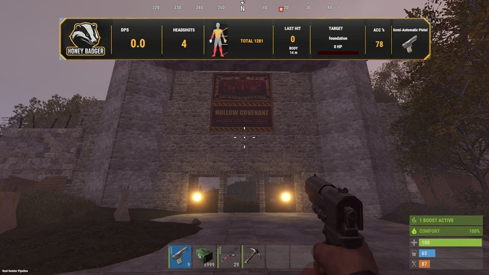
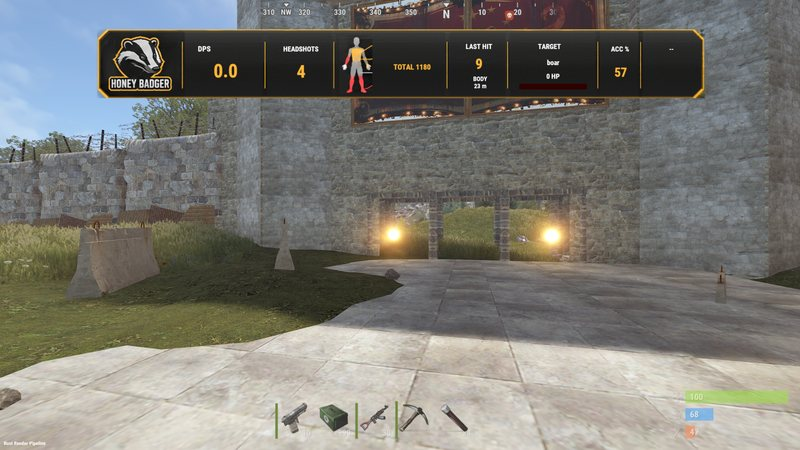
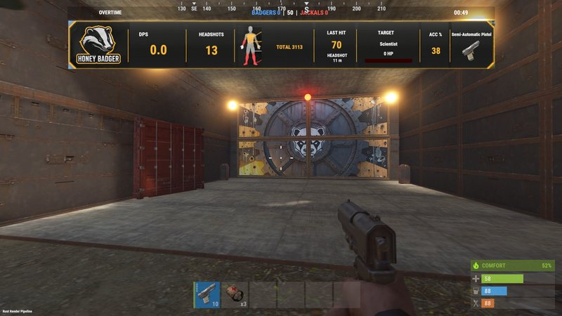
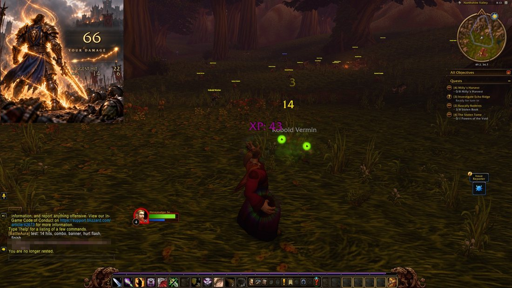

<picture>
  <source media="(prefers-color-scheme: dark)" srcset="assets/hero-dark.svg">
  <source media="(prefers-color-scheme: light)" srcset="assets/hero-light.svg">
  
</picture>

Mods, servers and tools for EVE Frontier, Rust, WoW Forever and EVE Online, built by one person.

**War Room** · PvP intel for EVE Frontier, read from the public chain. [Open it](https://honeybadger.software/frontier/warroom/)

**Bounty Board** · post a bounty on any pilot; the game's killmail is the proof. Nobody has collected one yet, so collection is still untested, and "Earned" on the board means a kill qualified, not that it was paid. [Open it](https://honeybadger.software/frontier/bounty/) · [source](https://github.com/honeybadger-software/eve-frontier-bounty-board)

**Honey Badger Rust server** · Carbon, with my own build tool, map tool, DPS HUD and deathmatch mode.

**Battle Aura** · personal damage meter for WoW Forever. [CurseForge](https://www.curseforge.com/wow/addons/battle-aura) · [source](https://github.com/honeybadger-software/battle-aura)

**EVE Fleet Foreman** · free mining helper for EVE Online. [Source and download](https://github.com/honeybadger-software/eve-fleet-foreman)

[honeybadger.software](https://honeybadger.software) · [@HoneyBadgerMods](https://x.com/HoneyBadgerMods) · more on [MIKE818964](https://github.com/MIKE818964)

EVE Frontier material is used with limited permission of CCP Games. Not affiliated with or endorsed by CCP Games, Facepunch or Blizzard.
